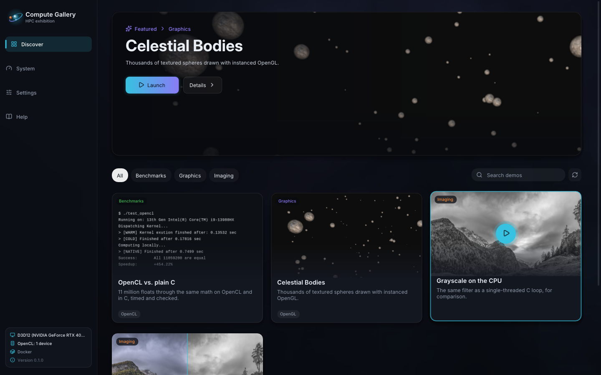
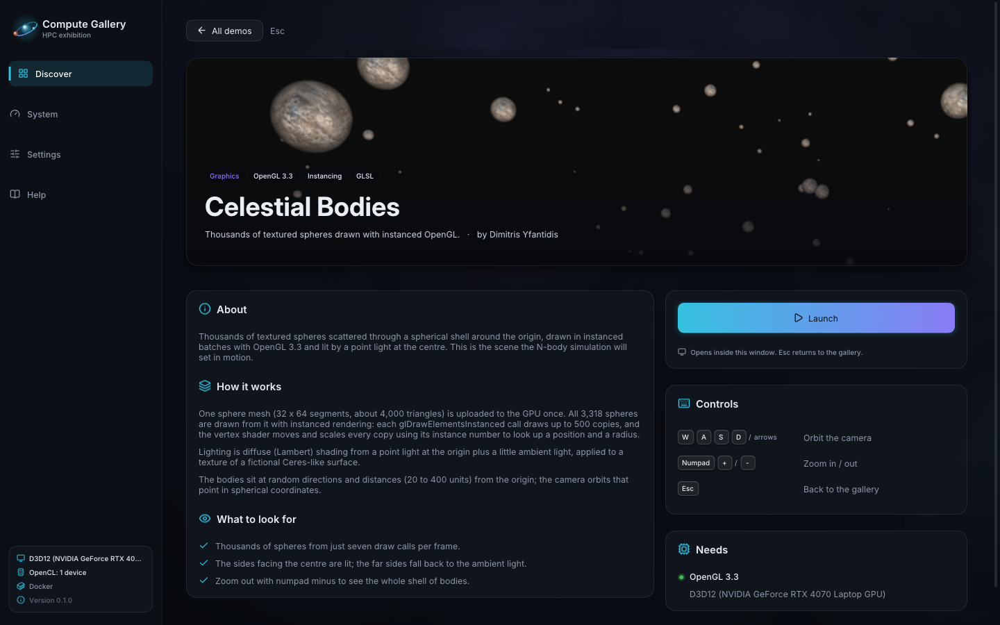

<picture>
  <source media="(prefers-color-scheme: dark)" srcset="docs/logo-dark.png">
  
</picture>

# HPC Exhibition Gallery

Goofy OpenCL tomfoolery that includes:
* Gaussian Blurring
* N-body problem



**Compute Gallery** is the app that shows them. Each demo has a page that explains what it shows, how it
works and what to look for, with its settings and controls. Press Launch and it runs **inside the gallery's
window**; Esc brings you back. Programs without a window show their output there instead. **System** explains
what the computer offers the demos (GPU, OpenCL devices, rendering), **Settings** picks the OpenCL device and
more, and **Help** covers the rest.



| Demo | What it shows | Needs |
|---|---|---|
| Celestial Bodies (`bodies`) | Thousands of textured spheres drawn with instanced OpenGL 3.3 | OpenGL |
| Grayscale on the GPU (`grayscale_gpu`) | A large photo converted to grayscale by an OpenCL kernel | OpenCL |
| Grayscale on the CPU (`grayscale_cpu`) | The same filter as a single-threaded C loop | - |
| OpenCL vs. plain C (`test_opencl`) | 11M floats through the same math in OpenCL and C, timed and checked | OpenCL |

`test_sdl` is a development smoke test and is not part of the gallery or the release packages.

## Download

Releases are on the [Releases page](../../releases). Unzip and run `compute-gallery` (on macOS,
*Compute Gallery.app*).

| System | Package | Before the first run |
|---|---|---|
| Windows 10/11, x64 | `compute-gallery-<version>-windows-x64.zip` | Nothing: OpenCL comes with the GPU driver. The program is not code-signed, so SmartScreen asks once: *More info* > *Run anyway*. |
| Linux x64 (Ubuntu 24.04 or newer) | `compute-gallery-<version>-linux-x64.tar.gz` | `sudo apt install libsdl2-2.0-0 libsdl2-image-2.0-0 ocl-icd-libopencl1` plus an OpenCL driver: your GPU vendor's, or `pocl-opencl-icd` for the CPU. |
| macOS 13.3+, Apple Silicon | `compute-gallery-<version>-macos-arm64.zip` | The app is not notarized: run `xattr -dr com.apple.quarantine "Compute Gallery.app"` once, then open it. Contains the gallery and the OpenGL demos only: Apple's OpenCL stops at version 1.2, which the OpenCL demos do not support. |

Demos that need something the machine lacks (for example, no OpenCL driver) stay visible but greyed out,
with the reason. On Windows and on Linux with X11 a demo's window is placed inside the gallery; on macOS and
Wayland, which do not allow that, it opens in its own window and the gallery returns when it closes. **Stop**
asks a demo to quit (its windows are closed on Windows, SIGTERM elsewhere) and ends it, along with anything it
started, if it is still running three seconds later; pressing it again ends it at once.
The chosen OpenCL device, the selected demo, the window size and demo settings are remembered in
`%APPDATA%\compute-gallery` (Windows), `~/Library/Application Support/compute-gallery` (macOS) or
`~/.config/compute-gallery` (Linux).

## Adding a demo

A demo is any program: C, C++, CUDA, Python, anything with an executable. It does not link against the
gallery or change for it. To show it in the gallery:

1. Build it from CMake as usual (see `CMakeLists.txt` for the existing ones) and add an `install()` rule, so
   it lands in the release package.
2. Add a folder `gallery/demos/<id>/` with a `demo.json` and, optionally, a 16:9 `thumbnail.png`
   (640x360 is plenty).

```json
{
    "title": "N-body on the GPU",
    "category": "Compute",
    "author": "Your Name",
    "summary": "One line for the card.",
    "description": "A paragraph for the details panel.",
    "executable": "nbody/nbody",
    "args": ["--fullscreen"],
    "env": {"SOME_VAR": "value"},
    "requires": ["opencl", "opengl"],
    "platforms": ["windows", "linux"],
    "controls": [["W A S D", "Move"], ["Esc", "Quit"]],
    "thumbnail": "thumbnail.png",
    "how_it_works": ["A paragraph on the technique.", "Another one."],
    "highlights": ["Something to notice while it runs."],
    "tags": ["OpenCL", "N-body"],
    "window": "embed",
    "options": [
        {"id": "bodies", "label": "Bodies", "type": "int", "min": 100, "max": 100000, "default": 10000,
         "args": ["--bodies", "{value}"], "help": "Number of simulated bodies"},
        {"id": "dt", "label": "Time step", "type": "float", "min": 0.001, "max": 0.1, "default": 0.01,
         "args": ["--dt={value}"]},
        {"id": "vsync", "label": "VSync", "type": "bool", "default": true, "args": ["--vsync"]},
        {"id": "device", "label": "Run on", "type": "choice", "choices": ["gpu", "cpu"], "default": "gpu",
         "env": "NBODY_DEVICE"}
    ]
}
```

| Field | Meaning |
|---|---|
| `executable` | Path relative to the gallery executable, without `.exe` (added on Windows). Required. A bare name such as `python3` that is not shipped with the gallery is looked up on the `PATH`, which is how interpreted demos run (`"executable": "python3", "args": ["main.py"]`). |
| `working_directory` | Relative to the gallery executable; defaults to the folder the executable is in, or for a program from the `PATH`, the demo's own folder (where its scripts are). |
| `args`, `env` | Always passed to the demo. |
| `how_it_works`, `highlights`, `tags` | The explanations and labels on the demo's page. |
| `window` | `embed` (default): shown inside the gallery where the system allows. `separate`: always its own window. `none`: no window; its output fills the gallery while it runs. |
| `options` | Settings shown above the Launch button: `int` and `float` sliders (`min`, `max`), `bool` checkboxes and `choice` lists (`choices`). Each value is passed through `args`, where `{value}` is replaced (a `bool` adds its `args` only when on), and/or the environment variable `env`. Optional `help` is shown on hover. |
| `requires` | `opencl` greys the demo out when no OpenCL device exists; `opengl` is informational. |
| `platforms` | Leave out to allow every OS; otherwise any of `windows`, `linux`, `macos`. |
| `category` | Cards are filtered by category; new categories appear automatically. |

The gallery reads the manifests when it starts and when you press **Refresh** (F5), so a new folder needs no
change to the gallery's code.
A demo behaves best when launched from it if it follows three conventions:

* **Data files:** in release packages the gallery starts the demo in its own folder. Load data relative to the
  working directory there (see how `CG_RELOCATABLE` sets `DATA_DIRECTORY_PATH` and `PROJECT_ROOT_PATH` in
  `CMakeLists.txt`).
* **Console output:** standard output reaches the console through a pipe, which buffers. Flush
  (`std::endl`, `fflush(stdout)`) for lines to appear while the demo is still running.
* **OpenCL device:** when a device is chosen in the gallery, it sets `CG_CL_PLATFORM` and `CG_CL_DEVICE`;
  demos using `select_device()` from `common.c` follow it automatically.
* **Quitting:** a demo should exit on Esc, when its window is closed (Windows) and on SIGTERM (Linux, macOS),
  which is what GLFW and SDL programs do by default. Standard input is empty, so a demo never waits for typed
  input.
* **Inside the gallery:** the gallery resizes a demo's window to fit, so a demo that redraws every frame (or on
  resize) fills the space; one that draws only once keeps its first picture. On Linux the gallery asks GLFW and
  SDL programs for X11 (through XWayland in a Wayland session) so they can be placed inside it.

## Developing in Docker

Needs [Docker](https://docs.docker.com/get-started/get-docker/) (Docker Desktop on Windows and macOS).

```
./run.sh        # Linux, macOS, WSL, Git Bash
.\run.cmd       # PowerShell or cmd on Windows (uses Git for Windows' bash)
```

It detects your OS and GPU, starts the matching container, builds what changed and opens the gallery; when you
close the gallery the container stops, so Docker frees its memory (`CG_KEEP_RUNNING=1` keeps it running). The
gallery's System page has the diagnostics and, since it runs from a build folder, a Rebuild button.

The text menu from before is `./run.sh menu`, and every entry also works as a command: `./run.sh bodies`,
`./run.sh shell`, `./run.sh stop`. If something does not work, `./run.sh doctor` checks Docker, the GPU, the
display and OpenCL and says how to fix what it finds; `./run.sh help` lists everything.

[compose.yaml](compose.yaml) defines one service per kind of host, all built from the same [Dockerfile](Dockerfile)
(Ubuntu 24.04). To use it by hand:

```
docker compose up -d --build cpu
docker compose exec cpu bash
```

| Host | Service | OpenGL | OpenCL |
|---|---|---|---|
| Linux + NVIDIA, X11 desktop | `linux-nvidia` | NVIDIA GPU | NVIDIA GPU (+ PoCL CPU) |
| Windows 10/11, Docker Desktop (WSL2) | `windows-wsl` | NVIDIA GPU via D3D12, WSLg | PoCL on all CPU cores |
| Same, AMD or Intel GPU | `windows-wsl-amd-intel` | GPU via D3D12, WSLg | PoCL on all CPU cores |
| Anything else (macOS, no GPU, CI) | `cpu` | Mesa llvmpipe (software) | PoCL on all CPU cores |

* **Linux + NVIDIA** needs the [NVIDIA Container Toolkit](https://docs.nvidia.com/datacenter/cloud-native/container-toolkit/latest/install-guide.html).
  Run `xhost +SI:localuser:$(id -un)` once so the container can open windows, and
  `export HOST_UID=$(id -u) HOST_GID=$(id -g)` before building so files you create in the workspace stay yours
  (`run.sh` does both).
* **Windows**: Docker Desktop gives containers no GPU OpenCL driver, so OpenCL runs on the CPU there; OpenGL does
  use the GPU. Built natively (below, or the release package), OpenCL runs on the GPU.
* **macOS**: Docker runs Linux in a VM with no GPU access, so the container is CPU-only. Windows open in a browser
  desktop at <http://localhost:6080/vnc.html> (bound to localhost only).

Inside the container, `clinfo -l` lists the OpenCL devices and `glxinfo -B` shows the OpenGL renderer. The
programs pick the first GPU, falling back to the first device of any kind; override with `CG_CL_PLATFORM=<i>`
and/or `CG_CL_DEVICE=<i>`.

### Developing in Visual Studio Code (VSCode)

* Download [Microsoft's Dev Containers extension](https://marketplace.visualstudio.com/items?itemName=ms-vscode-remote.remote-containers) `ms-vscode-remote.remote-containers` for your editor. 
* Create `./devcontainer/devcontainer.json` and paste the following JSON template inside of it. Make sure to make the appropriate changes udner the `"service"` and `"runServices"` fields to match your platform (e.g. `linux-nvidia`):

```json
// For format details, see https://aka.ms/devcontainer.json. For config options, see the
// README at: https://github.com/devcontainers/templates/tree/main/src/docker-existing-docker-compose
{
	"name": "VSCode Container Extension",

	// Update the 'dockerComposeFile' list if you have more compose files or use different names.
	// The .devcontainer/docker-compose.yml file contains any overrides you need/want to make.
	"dockerComposeFile": [
		"../compose.yaml"
	],

	// The 'service' property is the name of the service for the container that VS Code should
	// use. Update this value and .devcontainer/docker-compose.yml to the real service name.
	"service": ...,

	// The optional 'workspaceFolder' property is the path VS Code should open by default when
	// connected. This is typically a file mount in .devcontainer/docker-compose.yml
	"workspaceFolder": "/home/workspace",

	// Features to add to the dev container. More info: https://containers.dev/features.
	// "features": {},

	// Use 'forwardPorts' to make a list of ports inside the container available locally.
	// "forwardPorts": [],

	// Uncomment the next line if you want start specific services in your Docker Compose config.
	"runServices": [
		...
	]

	// Uncomment the next line if you want to keep your containers running after VS Code shuts down.
	// "shutdownAction": "none",

	// Uncomment the next line to run commands after the container is created.
	// "postCreateCommand": "cat /etc/os-release",

	// Configure tool-specific properties.
	// "customizations": {},

	// Uncomment to connect as an existing user other than the container default. More info: https://aka.ms/dev-containers-non-root.
	// "remoteUser": "devcontainer"
}
```

## Building natively

These are the commands the [build workflow](.github/workflows/build.yml) runs on every pull request. GLFW, GLAD,
Dear ImGui and the other small libraries are downloaded by CMake; GLM and stb are used from the system when
installed. GLAD generates its OpenGL loader with Python, which needs the Jinja2 package.

**Linux** (Ubuntu 24.04):

```
sudo apt-get install -y build-essential cmake ninja-build python3-jinja2 libglm-dev libstb-dev \
  ocl-icd-opencl-dev opencl-headers libsdl2-dev libsdl2-image-dev libgl1-mesa-dev \
  libx11-dev libxrandr-dev libxinerama-dev libxcursor-dev libxi-dev \
  libwayland-dev libxkbcommon-dev wayland-protocols
cmake -S . -B build -G Ninja -DCMAKE_BUILD_TYPE=Release
cmake --build build
./build/compute-gallery
```

**Windows**: install [MSYS2](https://www.msys2.org/), open the **MSYS2 UCRT64** shell, then:

```
pacman -S --needed mingw-w64-ucrt-x86_64-gcc mingw-w64-ucrt-x86_64-cmake mingw-w64-ucrt-x86_64-ninja \
  mingw-w64-ucrt-x86_64-python-jinja mingw-w64-ucrt-x86_64-SDL2 mingw-w64-ucrt-x86_64-SDL2_image \
  mingw-w64-ucrt-x86_64-opencl-icd mingw-w64-ucrt-x86_64-opencl-headers mingw-w64-ucrt-x86_64-glm git
cmake -S . -B build -G Ninja -DCMAKE_BUILD_TYPE=Release
cmake --build build
./build/compute-gallery.exe
```

Run it from the same shell, which has the SDL2 DLLs on its `PATH`; the release package bundles them instead.

**macOS** (Apple Silicon or Intel, with the Xcode command line tools):

```
brew install cmake ninja
python3 -m venv .venv && source .venv/bin/activate && pip install jinja2
cmake -S . -B build -G Ninja -DCMAKE_BUILD_TYPE=Release -DCG_BUILD_OPENCL=OFF
cmake --build build
./build/compute-gallery
```

**Tests**: `ctest --test-dir build` runs the gallery's tests (launching and stopping demos, manifests,
settings); they need no window or GPU.

**A package like the release ones**: add `-DCG_RELOCATABLE=ON -DCG_NATIVE_ARCH=OFF` when configuring, then
`cmake --install build --prefix dist/compute-gallery`. The resulting folder runs from anywhere; on macOS it is
*Compute Gallery.app*.

The app icon is drawn in `gallery/assets/icon/compute-gallery.svg`; `render.sh` next to it regenerates the
PNG, ICO and ICNS files from it. The gallery draws the same mark itself (`gallery/src/logo.cpp`).

| Option | Default | Effect |
|---|---|---|
| `CG_BUILD_GALLERY` | `ON` | Build the gallery launcher |
| `CG_BUILD_BODIES` | `ON` | Build the OpenGL renderer |
| `CG_BUILD_OPENCL` | `ON` | Build the OpenCL / SDL2 demos (skipped with a warning if the libraries are missing) |
| `CG_NATIVE_ARCH` | `ON` | Tune for the build machine's CPU; turn off for binaries that run elsewhere |
| `CG_RELOCATABLE` | `OFF` | Demos look up data next to themselves instead of in the source tree, for packages |

## Releasing

Push a version tag; the build workflow builds all three packages and publishes them as a GitHub Release:

```
git tag v0.1.0
git push origin v0.1.0
```

Third-party components and their licenses are listed in [THIRD_PARTY_NOTICES.md](THIRD_PARTY_NOTICES.md).
